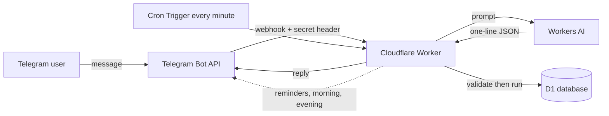

<div align="center">

# 🪽 hermes-mini

**دستیار شخصی کارهای روزانه روی تلگرام، با متن آزاد فارسی**

بدون سرور شخصی • بدون دستور • کاملاً روی پلن رایگان Cloudflare

[🌐 آدرس زنده](https://hermes-mini.masoume-hermes.workers.dev/health)

</div>

---

## ✨ این پروژه چیه؟

فقط عادی بنویس، خودش می‌فهمه:

| تو می‌نویسی | اتفاقی که می‌افته |
|---|---|
| «نان و شیر بخر» | دو کار جدا ثبت می‌شه |
| «کلاس فردا ساعت ۸ صبح» | کار با ساعت ثبت می‌شه و سر وقت یادآوری می‌رسه |
| «قرص رو ۱۰ دقیقه دیگه یادآوری کن» | یادآوری تنظیم می‌شه |
| «نان رو خریدم» | تیک می‌خوره |
| «کارام چیه» | لیست با تاریخ شمسی و روز هفته |
| «اسم شماره ۲ رو تغییر بده به خرید نان تازه» | اسم عوض می‌شه |
| «همه رو حذف کن» | اول می‌پرسه «مطمئنی؟»؛ فقط با «تایید» حذف می‌کنه |

**هیچ slash command ای وجود نداره.** فهمیدن پیام و تصمیم‌گیری کاملاً با مدل زبانیه.

## 🧠 اصل طراحی: «مدل پیشنهاد می‌ده، کد اجرا می‌کنه»

مدل فقط **یک خط JSON** برمی‌گردونه و هیچ‌وقت مستقیم به دیتابیس دست نمی‌زنه. کد خودمون اون JSON رو اعتبارسنجی می‌کنه و فقط اگه معتبر بود، عمل می‌کنه:

- اکشن باید یکی از `add / done / undone / del / rename / settime / list / chat` باشه.
- شماره‌ی هر کار باید **واقعاً توی دیتابیس وجود داشته باشه**؛ شماره‌ی ساختگی مدل نادیده گرفته می‌شه.
- «همه» رو **خود کد** از دیتابیس حساب می‌کنه، نه مدل (با مدل کوچک، کپی کردن چند شماره ناپایدار بود).
- ساعت باید فرمت معتبر `HH:MM` داشته باشه؛ مدل حق نداره ساعت از خودش بسازه.
- خروجی خراب یا نامعتبر ⇐ جواب امن «متوجه نشدم» و **هیچ نوشتنی در دیتابیس**.
- پیام مبهم («اون یکی رو پاک کن») حذف نمی‌کنه و می‌پرسه کدوم.

## 🏗 معماری



| بخش | چرا؟ |
|---|---|
| **Webhook (نه polling)** | کد فقط وقتی پیام بیاد اجرا می‌شه؛ بدون حلقه‌ی همیشه‌روشن و بدون مصرف بیهوده |
| **Serverless / FaaS** | بار کاری پراکنده و کوچیکه؛ نه VM و نه Docker لازمه، و روی پلن رایگان می‌گنجه |
| **D1 (نه KV)** | داده‌ها رابطه‌ای و پرس‌وجوشدنیه (وضعیت، ساعت، شماره‌ی خالی، ترتیب)؛ SQL این‌ها رو ساده‌تر و قابل‌اعتمادتر انجام می‌ده |
| **State** | همه‌چیز توی D1؛ بین ریستارت‌ها و از هر دستگاه ثابت می‌مونه. خود Worker هیچ state ای نگه نمی‌داره |
| **Workers AI** | بدون API key جداگانه و روی همون پلن رایگان |

## 🔐 امنیت

- هر درخواست `/webhook` بدون هدر `X-Telegram-Bot-Api-Secret-Token` درست، **`403`** می‌گیره.
- فقط شناسه‌ی تلگرام مجاز پردازش می‌شه؛ بقیه **بی‌صدا** رد می‌شن (حتی جواب هم نمی‌گیرن).
- بعد از احراز هویت، همیشه **`200`** برمی‌گرده تا تلگرام پیام رو دوباره نفرسته.
- توکن بات و رمز webhook **فقط توی secret store کلودفلرن**؛ هیچ‌جای کد یا ریپو نیستن.
- متغیرهای غیرمحرمانه (`ALLOWED_USER_ID`، `MODEL`) توی `wrangler.toml` هستن؛ فرق «variable» و «secret» رعایت شده.
- تأیید حذف گروهی بعد از ۲ دقیقه منقضی می‌شه.

## ⏰ زمان (Tehran)

سرور کلودفلر منطقه‌ی زمانی خودش رو نداره، پس:

- «امروز»، «فردا» و ساعت یادآوری همه با `Intl.DateTimeFormat` و منطقه‌ی **`Asia/Tehran`** حساب می‌شن.
- ساعت‌های کاربر به‌صورت تاریخ و ساعت کامل (به وقت تهران) ذخیره می‌شن، پس «فردا ساعت ۸» هم کار می‌کنه.
- اگر ساعتِ امروز گذشته باشه، کار برای فردا ثبت می‌شه و بات می‌گه.
- زمان‌های ثبت‌شده توسط دیتابیس (`done_at`) UTC هستن و موقع خوندن به تهران تبدیل می‌شن.

## 🔔 کارهای خودکار (Cron هر دقیقه)

| کار | رفتار |
|---|---|
| یادآوری سر ساعت | فقط برای کار باز، فقط یک بار. اگر ارسال شکست بخوره، دقیقه‌ی بعد دوباره امتحان می‌شه (*at-least-once*) |
| پیام صبحگاهی | روزی یک بار، از ساعت ۸ تهران، با لیست. اگر یه بار از دست بره، جبران می‌شه |
| خلاصه‌ی شبانه | ساعت ۲۱؛ تعداد انجام‌شده و مانده، و 🔥 برای روزهای پشت‌سرهمِ موفق |

## 🗂 ساختار

```
src/index.js                             کل منطق Worker
migrations/0001_init.sql                 جدول tasks و chat_history
migrations/0002_add_state_and_time.sql   جدول state و ستون‌های time و reminded
wrangler.toml                            binding ها، cron و متغیرهای غیرمحرمانه
```

Migrationها **جدا از کد** هستن و هر تغییر دیتابیس یک فایل جدید می‌گیره (فایل اجراشده هیچ‌وقت ویرایش نمی‌شه).

## ⚙️ تنظیمات

| نام | نوع | توضیح |
|---|---|---|
| `BOT_TOKEN` | 🔒 secret | توکن بات از @BotFather |
| `WEBHOOK_SECRET` | 🔒 secret | رشته‌ی تصادفی؛ باید با `secret_token` توی `setWebhook` یکی باشه |
| `ALLOWED_USER_ID` | variable | تنها کاربر مجاز |
| `MODEL` | variable | مدل Workers AI (قابل‌تعویض با یک خط) |
| `EVENING_HOUR` | variable (اختیاری) | ساعت خلاصه‌ی شبانه، پیش‌فرض ۲۱ |
| `DB`, `AI` | binding | دیتابیس D1 و Workers AI |

## 🚀 راه‌اندازی

```bash
npm install
npx wrangler login

# دیتابیس (database_id رو توی wrangler.toml بگذار)
npx wrangler d1 create hermes-db
npx wrangler d1 migrations apply hermes-db --remote

# secretها (مقدار رو وقتی wrangler می‌پرسه وارد کن، نه توی خود دستور)
npx wrangler secret put BOT_TOKEN
npx wrangler secret put WEBHOOK_SECRET

# دیپلوی
npx wrangler deploy
```

معرفی webhook به تلگرام (مقدارها رو جایگزین کن):

```
https://api.telegram.org/bot<TOKEN>/setWebhook?url=<WORKER_URL>/webhook&secret_token=<WEBHOOK_SECRET>
```

مشاهده‌ی لاگ زنده و سلامت سرویس:

```bash
npx wrangler tail
curl <WORKER_URL>/health      # ok
```

## 🧪 تست امنیت

```bash
# بدون secret ⇐ باید 403 forbidden برگرده
curl -i -X POST <WORKER_URL>/webhook -H "Content-Type: application/json" -d "{}"
```

## ⚠️ محدودیت‌های شناخته‌شده

- فقط یک کاربر؛ ۵۰ کار اول به لیست و مدل داده می‌شن.
- تاریخ‌ها فقط «امروز» و «فردا»؛ کار تکرارشونده نداریم.
- دقت یادآوری حدود یک دقیقه‌ست.

---

<div align="center">
ساخته‌شده برای پروژه‌ی درس رایانش ابری ☁️
</div>
